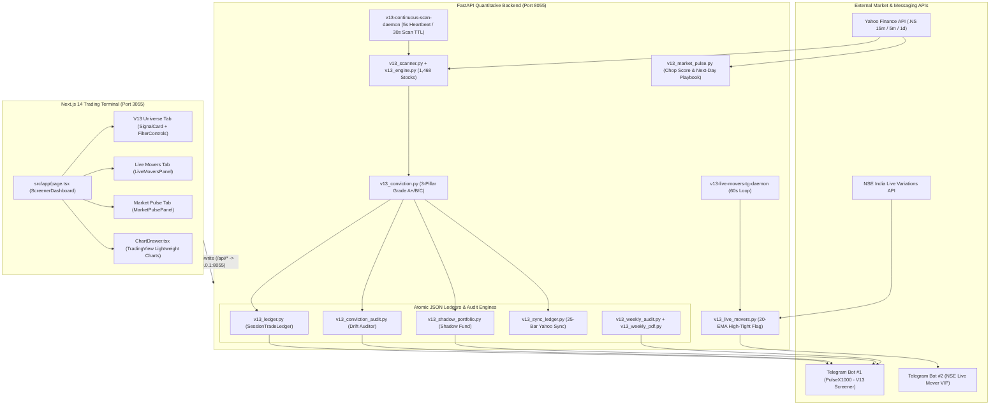

# NSE-PULSE V13 / V14 — Quantitative Intraday Stock Screener & Autonomous Trading Ecosystem

**NSE-PULSE V13 / V14** is a full-stack, institutional-grade quantitative intraday stock screener, real-time momentum scanner, trade execution planner, and autonomous paper-trading ecosystem built specifically for the **National Stock Exchange of India (NSE)**.

It combines a **Python FastAPI** quantitative backend (scanning up to **1,468+ NSE stocks** with Market Cap $\ge \text{₹1,000 Crore}$) with a **Next.js 14 (React 18 + TypeScript)** real-time trading terminal, **TradingView Lightweight Charts**, dual **Telegram Bot channels**, an **Autonomous Shadow Portfolio**, and a multi-ledger **End-of-Day (EOD) & Weekly Performance Audit Engine**.

---

## Table of Contents

1. [Project Overview](#1-project-overview)
2. [Key Features](#2-key-features)
3. [Technology Stack](#3-technology-stack)
4. [Project Architecture](#4-project-architecture)
5. [Complete Folder Structure](#5-complete-folder-structure)
6. [Important Files Explained](#6-important-files-explained)
7. [How the Application Works (End-to-End Lifecycle)](#7-how-the-application-works-end-to-end-lifecycle)
8. [Installation and Setup](#8-installation-and-setup)
9. [Environment Variables and Configuration](#9-environment-variables-and-configuration)
10. [How to Run the Project](#10-how-to-run-the-project)
11. [Development Workflow](#11-development-workflow)
12. [API Documentation](#12-api-documentation)
13. [Data Storage & Persistence Structure](#13-data-storage--persistence-structure)
14. [Authentication and Security](#14-authentication-and-security)
15. [Testing & Verification](#15-testing--verification)
16. [Build and Deployment](#16-build-and-deployment)
17. [Dependencies and External Integrations](#17-dependencies-and-external-integrations)
18. [Error Handling and Troubleshooting](#18-error-handling-and-troubleshooting)
19. [Limitations and Known Issues](#19-limitations-and-known-issues)
20. [Contribution Guidelines](#20-contribution-guidelines)
21. [Future Improvements](#21-future-improvements)

---

## 1. Project Overview

### What Problem Does This Project Solve?
Intraday traders on the National Stock Exchange of India (NSE) face three major challenges:
1. **Scale**: Manually scanning 500 to 1,500+ stocks every 15 minutes during live market hours (`09:15 AM – 03:30 PM IST`) is humanly impossible.
2. **False Breakouts & Market Chop**: Retail indicators trigger false signals when the broader index (`NIFTY 50`) or sector breadth opposes the trade, or when relative volume is skewed by morning/closing volume spikes.
3. **Lack of Post-Trade Accountability**: Most screeners flash symbols on a screen and delete them when they fail, making it impossible to audit true win rates, slippage, or conviction decay.

### How NSE-PULSE Solves It
- **Broad Institutional Universe**: Scans a curated universe of **1,468+ NSE stocks** with Market Capitalization $\ge \text{₹1,000 Cr}$ (`universe_1000cr.json`) alongside the **Nifty 500** benchmark (`nifty500.json`).
- **Multi-Factor Quantitative Scoring (`0–100`)**: Evaluates Opening Range Breakouts (`09:15–09:30 AM`), Previous Day High/Low (`PDH/PDL`) breakouts, Session VWAP alignment, 20 EMA structure, Wilder's 14-period RSI & ATR, Time-of-Day Slot-Normalized Relative Volume (`RelVol`), and True Velocity.
- **3-Pillar Real-Time Conviction Stamp (`Grade A+`, `Grade B`, `Grade C`)**: Cross-checks every stock setup against live **NIFTY 50 Intraday Flow**, **1,468-Stock Sector Breadth**, and **15m Candle Breakout Purity (Wick Ratio)**.
- **Zero-Deletion Ratchet Ledger & Dual Telegram Bots**: Once a trade triggers, it is permanently recorded in a session ledger (`session_trade_ledger.json` and `live_movers_session_ledger.json`), tracked tick-by-tick through a **Dual-Tranche "Never-Lose-A-Winner" Lifecycle** (`T1_HIT_TRAILED`, `T1_WIN_BE_EXIT`, `T2_HIT`, `SL_HIT`, or `15:30 PM` EOD MTM settlement), and audited automatically at `15:30–15:36 PM IST`.

### Intended Users
- Quantitative intraday equity and F&O traders on the Indian stock market (NSE).
- System developers and researchers backtesting 15-minute intraday breakout and momentum strategies.

---

## 2. Key Features

### 1. V13 / V14 Quantitative Discovery Engine ([`v13_engine.py`](./backend/app/v13_engine.py), [`v13_scanner.py`](./backend/app/v13_scanner.py))
- **Independent Bullish & Bearish Evaluation**: Evaluates long and short setups independently on 15-minute OHLCV candles (`25 bars` per NSE session).
- **Gate #0 Shortability Guard**: Restricts `BEARISH` (short) candidates strictly to liquid F&O, Nifty 50, Nifty Next 50, and Nifty Midcap 50 constituents (`nse_index_constituents.json`) to prevent shorting illiquid cash stocks.
- **09:35 AM 5-Minute Micro-Confirmation**: Verifies early breakouts using the `[09:30–09:35 AM]` 5-minute candle body ratio ($\ge 50\%$) and volume surge ($\ge 0.45 \times \text{Bar 1}$).
- **Time-of-Day Slot-Normalized `RelVol`**: Compares the current 15-minute bar's volume against the historical median/mean volume of the **exact same 15-minute clock slot** over the past 10 sessions, blended with session cumulative participation (`70% slot + 30% cumulative`).
- **Exact NSE 5-Paise Tick Normalization**: Uses integer-paise math (`normalize_nse_tick`) to eliminate IEEE-754 floating-point drift on all Entry, Stop-Loss, Target 1, and Target 2 prices.

### 2. Real-Time 3-Pillar Conviction Engine ([`v13_conviction.py`](./backend/app/v13_conviction.py))
Evaluates every candidate in `< 5ms` across three 1.0-point pillars (`Max Score: 3.0`):
1. **Pillar 1 — NIFTY 50 Intraday Flow (`1.0 pt`)**: Checks if NIFTY 50 slope and VWAP structure align with the trade direction.
2. **Pillar 2 — Universe Sector Breadth (`1.0 pt`)**: Checks if $\ge 60\%$ of stocks in the same sector are advancing/declining with the setup.
3. **Pillar 3 — Candle Breakout Purity (`1.0 pt`)**: Measures rejection wick ratio ($\le 25\%$ wick earns full `1.0 pt`; $> 40\%$ wick receives `0.0 pt`).
- Outputs an actionable stamp:
  - **Grade A+ (`2.5 – 3.0`)**: High Probability • Full Size (`100%`).
  - **Grade B (`1.5 – 2.0`)**: Moderate Probability • Half Size (`50%`).
  - **Grade C (`0.0 – 1.0`)**: Low Probability / Caution • Skip Trade (`0%` risk).

### 3. NSE Live Top Movers & 20-EMA High-Tight Flag Engine ([`v13_live_movers.py`](./backend/app/v13_live_movers.py))
- Connects directly to the official NSE Live Variations feed (with automatic Akamai session cookie management and universe fallback) to track Top 20 Gainers & Losers.
- Applies a **4-Tier Quantitative Filter** and computes dynamic **20-EMA Pullback / High-Tight Flag** trade execution plans (`Entry`, `Stop Loss`, `Target 1 @ 1.5R`, `Target 2 @ 2.5R`).
- Includes an anti-flicker `SessionMoverRegistry` (`45-minute` active retention) so qualified `RUNNER` and `SHORT_RUNNER` cards do not disappear between ticks.

### 4. Market Pulse & Structural Playbook Engine ([`v13_market_pulse.py`](./backend/app/v13_market_pulse.py))
- **Live Intraday Tradeability & Chop Filter (`0–100` Score)**:
  - Combines Dual-Window Efficiency Ratio (`Session ER` + `6-Candle Rolling Impulse ER`), 1,468-Stock Institutional VWAP Breadth, Range-Weighted Wick Ratio, ATR Fuel Consumed, and India VIX Velocity.
  - Outputs a clear **Traffic Light (`GREEN` / `YELLOW` / `RED`)** and position-sizing multiplier (`1.0x`, `0.5x`, or `0.0x Sit on Cash`).
- **Next-Day / Pre-Market Structural Playbook**:
  - 5-Pillar weighted directional model (`-100` to `+100`) incorporating Daily CLV, Daily EMA20/EMA50 structure, EOD Breadth, Overnight Global Macro (`S&P 500`, `Nasdaq`, `DXY`, `Brent Crude`), and `India VIX`.
  - Computes static conditional breakout/breakdown trigger zones (`U_trig`, `L_trig`) and targets for the session.

### 5. Dual-Bot Telegram Alerting & Automated EOD Audit Suite
- **Bot #1 — Primary V13 Screener Bot (`PulseX1000` via [`telegram_bot.py`](./backend/app/telegram_bot.py))**:
  - Dispatches real-time V13 breakout alerts (`Score >= 75`, `T1 Progress <= 25%`, `Grade A+/B`).
  - Dispatches 3 decoupled End-of-Day reports between `15:30 PM` and `15:36 PM IST`:
    1. **Primary V13 Session Performance Audit** (`15:30 PM` via [`v13_ledger.py`](./backend/app/v13_ledger.py)).
    2. **Conviction Drift & Regime Decay Audit** (`15:31 PM` via [`v13_conviction_audit.py`](./backend/app/v13_conviction_audit.py)).
    3. **Autonomous Shadow Portfolio EOD Scorecard** (`15:35 PM` via [`v13_shadow_portfolio.py`](./backend/app/v13_shadow_portfolio.py)).
  - On Fridays (or the last trading day before a holiday), automatically generates and sends a **Weekly Performance Audit + Institutional Multi-Page PDF Report** ([`v13_weekly_audit.py`](./backend/app/v13_weekly_audit.py), [`v13_weekly_pdf.py`](./backend/app/v13_weekly_pdf.py)).
- **Bot #2 — Dedicated NSE Live Movers VIP Bot (`NSE Live - Live Mover VIP` via [`v13_live_movers_telegram.py`](./backend/app/v13_live_movers_telegram.py))**:
  - Operates on its own independent bot token (`TELEGRAM_LIVE_MOVERS_BOT_TOKEN`) and 60-second background daemon (`09:15 AM – 03:00 PM IST` for alerts; `09:15 AM – 03:36 PM IST` for post-alert outcome tracking).
  - Tracks strictly post-alert live prices and dispatches a dedicated **NSE Live Movers EOD Performance Audit** at `15:30 PM IST` exclusively to the VIP channel.

### 6. Autonomous Conviction Shadow Portfolio ([`v13_shadow_portfolio.py`](./backend/app/v13_shadow_portfolio.py))
- Paper-trades every qualifying `Grade A+` (`₹1,000` risk) and `Grade B` (`₹500` risk) setup triggered before `13:30 IST` starting from a virtual `₹1,00,000` capital base.
- Implements a **50% Compounding / 50% Permanent Digital Vault** profit-splitting model and automatic `15:15 IST` MIS intraday square-off.

### 7. Yahoo Candle Sync & Trigger Precision Ledger ([`v13_sync_ledger.py`](./backend/app/v13_sync_ledger.py))
- Logs exact delivery timestamps and ingestion latency (`T2 - T1` in seconds) for all 25 intraday 15-minute bars (`09:15` to `15:30`).
- Records session-unique stock triggers (`score >= 72.0`) comparing `candle_close_price` (breakout entry) against `alert_ltp` (live snapshot price) to measure real-world price slippage.

---

## 3. Technology Stack

| Layer | Technology | Version | Purpose |
| :--- | :--- | :--- | :--- |
| **Backend Language** | Python | `3.11+` | Core quantitative computing, data ingestion, and async daemons |
| **Backend Framework** | FastAPI + Uvicorn | `0.141.1` / `0.52.4` | REST API server, background worker lifecycle, OpenAPI `/docs` |
| **Data & Math** | Pandas, NumPy | `3.0.5` / `2.5.3` | Vectorized OHLCV time-series processing and indicator math |
| **Market Data** | `yfinance`, `requests` | `1.7.0` / `2.31+` | Yahoo Finance `.NS` 15m/5m/1d feeds & direct NSE Live API |
| **Validation & Time** | Pydantic v2, `pytz` | `2.13.5` / `2026.3` | Schema validation and `Asia/Kolkata` (`IST`) timezone handling |
| **Frontend Framework** | Next.js (App Router) | `14.2.24` | React server/client rendering and `/api/*` proxy rewrites |
| **Frontend UI** | React, TypeScript, Tailwind CSS | `18.3.1` / `5.x` / `3.4.17` | Responsive dark-mode institutional trading terminal |
| **Financial Charting** | TradingView Lightweight Charts | `4.2.1` | Interactive 15m candlestick, volume, 20 EMA, RSI, and price lines |
| **Icons & Utilities** | `lucide-react`, `clsx`, `tailwind-merge` | `0.475.0` | UI iconography and conditional styling |

---

## 4. Project Architecture

The system follows a **decoupled microservice architecture** where background daemon threads in FastAPI continuously compute and cache market state in RAM and atomic JSON ledgers, allowing frontend API requests to return in milliseconds.



---

## 5. Complete Folder Structure

```text
nse-screener prediction-v13-dev/
├── backend/                                  # Python FastAPI backend service
│   ├── app/                                  # Core application package
│   │   ├── data/                             # Persistent JSON ledgers, universes, and caches
│   │   │   ├── active performance live eod/  # Active today's V13 session_trade_ledger.json
│   │   │   ├── conviction_audit_ledgers/     # Daily conviction drift audit JSON archives
│   │   │   ├── eod active/                   # Active eod_snapshot.json for instant boot hydration
│   │   │   ├── EOD performance history/      # Archived daily session trade ledgers (ledger_YYYY-MM-DD.json)
│   │   │   ├── EOD Snapshot history/         # Archived daily full EOD scan snapshots
│   │   │   ├── shadow_portfolio/             # Active autonomous shadow portfolio state
│   │   │   ├── shadow_portfolio_history/     # Historical daily shadow portfolio ledgers
│   │   │   ├── telegram notification audit/  # Active sent_alerts_cache.json & live_movers_session_ledger.json
│   │   │   ├── telegram notification history/# Archived daily Telegram alert logs
│   │   │   ├── weekly performance history/   # Weekly audit JSON, Markdown (.md), and PDF reports
│   │   │   ├── yahoo_sync_ledgers/           # Daily 25-bar Yahoo ingestion lag & trigger slippage ledgers
│   │   │   ├── nifty500.json                 # Nifty 500 constituent metadata
│   │   │   ├── nse_holidays.json             # Official NSE trading holidays calendar
│   │   │   ├── nse_index_constituents.json   # F&O, Nifty 50, Next 50, Midcap 50 shortable universe sets
│   │   │   ├── universe_1000cr.json          # Expanded 1,468-stock universe (Market Cap >= ₹1,000 Cr)
│   │   │   ├── universe_1000cr.csv           # CSV export of the 1,468-stock universe
│   │   │   └── *.pkl                         # Local pickled 15m OHLCV DataFrame caches for fast warmups/backtests
│   │   ├── main.py                           # FastAPI entry point, background daemons, and REST endpoints
│   │   ├── config.py                         # IST timezone, EOD reset time, and Nifty 500/universe loader
│   │   ├── v13_engine.py                     # Core V13/V14 15m quantitative discovery & scoring engine
│   │   ├── v13_scanner.py                    # Multi-chunk Yahoo Finance downloader, cache, & universe orchestrator
│   │   ├── v13_conviction.py                 # 3-Pillar real-time Conviction Rating & "Take Trade" stamp engine
│   │   ├── v13_conviction_audit.py           # Intraday conviction drift & regime decay auditor
│   │   ├── v13_ledger.py                     # SessionTradeLedger (Monotonic Ratchet + Dual-Tranche outcomes)
│   │   ├── v13_live_movers.py                # NSE Live Top 20 Gainers/Losers + 20-EMA High-Tight Flag engine
│   │   ├── v13_live_movers_telegram.py       # Dedicated VIP Telegram bot & EOD audit engine for Live Movers
│   │   ├── v13_market_context.py             # Point-in-time NIFTY 50 slope, ATR, and session VWAP builder
│   │   ├── v13_market_pulse.py               # Market Pulse (Chop Filter + 5-Pillar Next-Day Structural Playbook)
│   │   ├── v13_models.py                     # Dataclass/Pydantic models for V13 signals and responses
│   │   ├── v13_shadow_portfolio.py           # Autonomous virtual fund with 50% compounding & digital vault
│   │   ├── v13_sync_ledger.py                # 25-Bar Yahoo sync latency & trigger price slippage ledger
│   │   ├── v13_weekly_audit.py               # Friday/Pre-holiday weekly aggregation & Telegram dispatcher
│   │   ├── v13_weekly_pdf.py                 # Pure-Python PDF generator for weekly institutional reports
│   │   ├── telegram_bot.py                   # Primary V13 Telegram bot queue worker, alert formatter, & archiver
│   │   ├── nse_calendar.py                   # NSE holiday detection & pre-holiday weekly audit scheduling
│   │   ├── data_fetcher.py                   # Legacy V11 screener & 15m stock chart history provider
│   │   ├── indicators.py                     # Vectorized EMA(20), Wilder's RSI(14), RelVol, and trade levels
│   │   ├── screener.py                       # Legacy V11 3-pillar screener evaluation
│   │   ├── prediction_engine.py              # V12 multi-factor prediction setup evaluator
│   │   ├── market_context.py                 # Sector & market context builder for V12 predictions
│   │   ├── paper_trading.py                  # CSV-backed V12 paper trading tracker
│   │   └── models.py                         # Pydantic schemas for `/api/screener`, `/api/stocks/{symbol}/history`
│   ├── .env                                  # Backend environment variables & feature toggles (not committed)
│   ├── requirements.txt                      # Python package dependencies
│   ├── Dockerfile                            # Backend container build definition
│   ├── build_universe_1000cr.py              # Utility script to build the >= ₹1,000 Cr market cap universe
│   └── test_*.py / v13_1_*.py                # Quantitative backtesting, forensic audit, and unit test scripts
├── frontend/                                 # Next.js 14 TypeScript frontend application
│   ├── src/
│   │   ├── app/
│   │   │   ├── layout.tsx                    # Root HTML layout & metadata
│   │   │   ├── page.tsx                      # Main ScreenerDashboard controller & state manager
│   │   │   └── globals.css                   # Tailwind CSS imports & custom scrollbar/animation styles
│   │   ├── components/
│   │   │   ├── Navbar.tsx                    # Top bar: IST clock, market status, audio toggle, refresh controls
│   │   │   ├── CandleSyncBar.tsx             # Live 15m candle countdown bar & Yahoo sync status indicator
│   │   │   ├── HolidayAlertBanner.tsx        # Banner warning of upcoming or active NSE market holidays
│   │   │   ├── OverviewStats.tsx             # Top KPI cards (Universe size, Active Signals, Sentiment, Top RelVol)
│   │   │   ├── FilterControls.tsx            # Search, sector filter, signal tabs, sort selector
│   │   │   ├── SignalCard.tsx                # V13 signal card with conviction badge, trade plan, & ORB preview
│   │   │   ├── LiveMoversPanel.tsx           # NSE Live Movers & 20-EMA Active Runners interface
│   │   │   ├── MarketPulsePanel.tsx          # Market Pulse Chop Gauge, Traffic Light, & Next-Day Playbook UI
│   │   │   ├── MarketPulseTooltip.tsx        # Educational hover tooltips for Market Pulse metrics
│   │   │   ├── ChartDrawer.tsx               # Slide-over 15m TradingView chart + position size calculator
│   │   │   ├── PaperTradingPanel.tsx         # Paper trading summary panel
│   │   │   ├── Pagination.tsx                # Page navigation & page-size selector
│   │   │   ├── SkeletonLoader.tsx            # Shimmer loading placeholders
│   │   │   ├── EmptyState.tsx                # Zero-results state with quick filter reset
│   │   │   └── ToastNotification.tsx         # Pop-up toast alerts for new breakout signals
│   │   ├── lib/
│   │   │   ├── v13Adapter.ts                 # Normalizes backend `/api/v13/scan` payloads into frontend types
│   │   │   └── utils.ts                      # Currency/number formatters, Web Audio API chime, & TTS speech
│   │   └── types/
│   │       └── screener.ts                   # Complete TypeScript interfaces for V13, Live Movers, & Market Pulse
│   ├── next.config.js                        # Next.js API proxy rewrite (`/api/*` -> `http://127.0.0.1:8055/api/*`)
│   ├── tailwind.config.js                    # Tailwind theme configuration
│   ├── package.json                          # Frontend scripts and dependencies
│   └── Dockerfile                            # Multi-stage Node 20 Alpine production container build
├── tests/
│   └── test_v14_quant.py                     # Self-contained V14 quantitative regression test suite
├── start_all.bat                             # One-click Windows launcher (opens 3 tabs in Windows Terminal)
├── run_backend.bat                           # Frees port 8055 and launches FastAPI Uvicorn server
├── run_frontend.bat                          # Frees port 3055, clears `.next`, and launches Next.js dev server
├── docker-compose.yml                        # Multi-container orchestration for backend and frontend
├── NSE_PULSE_V13_MASTER_README.md            # Detailed internal V13 quantitative architecture reference
├── NSE_PULSE_V13_EXPANDED_PRODUCTION_MANUAL.md # Extended operator manual
└── README.md                                 # This comprehensive project documentation
```

> **Note on Excluded/Generated Files**:
> - `frontend/node_modules/` and `frontend/.next/` are generated build/dependency artifacts and are excluded from manual source inspection.
> - `*.bak` and `*_backup.py` files inside `backend/app/` and `frontend/src/` are historical development snapshots preserved during iterative upgrades and are not imported by the active runtime.
> - `scripts/` at the project root is currently an empty directory (`[]`).

---

## 6. Important Files Explained

### Backend Core Modules (`backend/app/`)

| File | Primary Responsibility & Key Logic |
| :--- | :--- |
| **[`main.py`](./backend/app/main.py)** | Application entry point. Initializes FastAPI, spawns two background daemon threads (`_v13_continuous_loop` and `_v13_live_movers_telegram_loop`), manages in-memory scan locks (`_V13_SCAN_LOCK`), coordinates EOD snapshot persistence (`eod_snapshot.json`), triggers post-scan and watchdog EOD audits at `15:30–15:36 IST`, and exposes 18 REST endpoints. |
| **[`v13_engine.py`](./backend/app/v13_engine.py)** | Pure quantitative evaluation engine (`discover_v13_setups`, `evaluate_v13_diagnostic`, `_evaluate_direction`). Computes Opening Range (`09:15–09:30`), PDH/PDL, Session VWAP, Wilder's ATR(14), Wilder's RSI(14), EMA(20), Time-of-Day Slot-Normalized `RelVol`, True Velocity, NSE 5-paise tick-normalized trade plans (`Entry`, `SL`, `T1`, `T2`), and a `0–100` quality score. |
| **[`v13_scanner.py`](./backend/app/v13_scanner.py)** | Universe orchestrator (`scan_v13_universe`). Downloads 15m OHLCV data from Yahoo Finance in 50-symbol chunks with thread-safe TTL caching (`120s` live / `300s` closed), applies Gate #0 shortability filtering (`_load_fno_and_liquid_symbols`), verifies 5m `[09:30–09:35]` micro-confirmation (`verify_0935_micro_confirmation`), and enriches every candidate with its 3-Pillar Conviction stamp. |
| **[`v13_conviction.py`](./backend/app/v13_conviction.py)** | Evaluates `evaluate_conviction_rating()` across Pillar 1 (`evaluate_nifty_flow`), Pillar 2 (`evaluate_sector_breadth`), and Pillar 3 (`evaluate_candle_purity`). Stamps each setup with `GRADE_A_PLUS`, `GRADE_B`, or `GRADE_C` and execution sizing advice. |
| **[`v13_ledger.py`](./backend/app/v13_ledger.py)** | Implements `SessionTradeLedger` (`GLOBAL_SESSION_LEDGER`). Enforces the **Monotonic Peak Ratchet** (stocks only upgrade tiers `WATCHLIST -> STRONG -> HIGH_CONFIDENCE`, never downgrade or disappear), **Immutable First Stage**, **Dual-Tranche Outcome Tracking** (`T1_HIT_TRAILED`, `T1_WIN_BE_EXIT`, `T2_HIT`, `SL_HIT`, `CLOSED_EOD_PROFIT/LOSS/FLAT`), and thread-safe `dispatch_eod_audit()`. |
| **[`telegram_bot.py`](./backend/app/telegram_bot.py)** | Manages the primary V13 Telegram bot (**PulseX1000**). Implements a rate-limited background queue (`1 msg/sec`), deduplicates daily alerts with conviction-upgrade bypass, formats rich Markdown trade cards (with Trailing SL guide and Classic 15m ORB comparison), and archives daily alerts into `telegram notification history/`. |
| **[`v13_live_movers.py`](./backend/app/v13_live_movers.py)** | Implements `NSELiveVariationsFetcher` (real-time NSE Gainers/Losers with Akamai cookie refresh), `SessionMoverRegistry` (45-min anti-flicker cache), and `compute_live_top_movers()` for 20-EMA High-Tight Flag (`LONG`) and Breakdown (`SHORT`) execution plans. |
| **[`v13_live_movers_telegram.py`](./backend/app/v13_live_movers_telegram.py)** | Manages the dedicated **NSE Live - Live Mover VIP** Telegram bot (`TELEGRAM_LIVE_MOVERS_BOT_TOKEN`). Enforces a strict `09:15–15:00 IST` alert gate, records alerts in `live_movers_session_ledger.json`, updates outcomes using strictly **post-alert** live LTP ticks (`update_live_movers_ledger_outcomes`), and dispatches the isolated VIP EOD report (`dispatch_live_movers_eod_audit`). |
| **[`v13_market_pulse.py`](./backend/app/v13_market_pulse.py)** | Computes `compute_v13_market_pulse()`: (1) Live Intraday Tradeability & Chop Score (`0–100`) with Efficiency Ratio, VWAP Breadth, Wick Ratio, ATR Fuel, and India VIX; (2) 5-Pillar Next-Day Structural Bias (`BULLISH` / `BEARISH` / `SIDEWAYS`) and static conditional trigger zones (`U_trig`, `L_trig`). |
| **[`v13_conviction_audit.py`](./backend/app/v13_conviction_audit.py)** | Implements `ConvictionAuditor` (`GLOBAL_CONVICTION_AUDITOR`). Tracks how conviction changes from trigger time (`T0`) to EOD (`T_end`) on closed 15m bars, pinpoints whether decay was caused by `NIFTY_REVERSAL` or `SECTOR_INVERSION`, and dispatches the 2nd EOD Telegram audit card. |
| **[`v13_shadow_portfolio.py`](./backend/app/v13_shadow_portfolio.py)** | Implements `ShadowPortfolioEngine` (`GLOBAL_SHADOW_PORTFOLIO`). Autonomously executes virtual trades (`Conviction >= 2.0`, entry before `13:30 IST`), manages 50% partial booking at T1 + breakeven trailing stop, squares off open MIS positions at `15:15 IST`, splits net profits `50/50` into Compounding Capital vs Secured Digital Vault, and dispatches the 3rd EOD Telegram audit card. |
| **[`v13_sync_ledger.py`](./backend/app/v13_sync_ledger.py)** | Implements `YahooSyncLedger` (`GLOBAL_SYNC_LEDGER`). Records delivery lag for each of the 25 intraday 15m bars (`record_bar_sync`) and session-unique trigger slippage (`record_trigger_alert` comparing `candle_close_price` vs `alert_ltp`). |
| **[`v13_weekly_audit.py`](./backend/app/v13_weekly_audit.py) & [`v13_weekly_pdf.py`](./backend/app/v13_weekly_pdf.py)** | Aggregates Monday–Friday session ledgers and Telegram archives into a comprehensive Weekly Performance Audit report, generates a dark-themed institutional PDF without external binary dependencies, and sends both to Telegram on Friday EOD (or Thursday EOD if Friday is an NSE holiday). |
| **[`data_fetcher.py`](./backend/app/data_fetcher.py)** | Powers `/api/stocks/{symbol}/history` for the interactive 15m chart drawer (instantly reusing `_V13_CACHE` DataFrames in `0ms` when available) and provides `/api/market-status`. |

### Frontend Core Modules (`frontend/src/`)

| File | Primary Responsibility & Key Logic |
| :--- | :--- |
| **[`src/app/page.tsx`](./frontend/src/app/page.tsx)** | Main `ScreenerDashboard` client component. Manages the 3 primary workspace tabs (`V13_UNIVERSE`, `LIVE_MOVERS`, `MARKET_PULSE`), polls `/api/v13/scan` and `/api/v13/market-pulse`, triggers Web Audio chimes and voice alerts on new breakouts, and coordinates filtering, sorting, pagination, and the slide-over `ChartDrawer`. |
| **[`src/lib/v13Adapter.ts`](./frontend/src/lib/v13Adapter.ts)** | Transforms raw `/api/v13/scan` JSON into strongly-typed `V13ScanResponse` objects, merging live universe snapshots (`price`, `change_pct`, `rel_vol`, `ema20`, `rsi14`, `vwap`) with active candidate trade plans. |
| **[`src/components/SignalCard.tsx`](./frontend/src/components/SignalCard.tsx)** | Displays an individual stock card with live LTP, 3-Pillar Conviction Badge (`Grade A+/B/C`), V13 Score breakdown tooltip, Target 1 progress bar, Execution Status badge (`FRESH ENTRY`, `ACTIVE`, `EXTENDED`), Trailing SL guide, and a 2-second press-and-hold **Classic 15m ORB Preview**. |
| **[`src/components/LiveMoversPanel.tsx`](./frontend/src/components/LiveMoversPanel.tsx)** | Renders the **NSE Live Top Movers & 20-EMA Active Runners** workspace with index category tabs (`V13_ACTIVE`, `COMBINED`, `NIFTY_50`, `BANK_NIFTY`, `FNO`, etc.), live freshness telemetry, and 1-click Telegram test ping. |
| **[`src/components/MarketPulsePanel.tsx`](./frontend/src/components/MarketPulsePanel.tsx)** | Renders the **Market Pulse** dashboard: Intraday Tradeability & Chop Gauge (`0–100`), Traffic Light banner, 5 sub-factor progress bars, Overnight Global Macro cards, and the Next-Day Conditional Execution Playbook. |
| **[`src/components/ChartDrawer.tsx`](./frontend/src/components/ChartDrawer.tsx)** | Slide-over drawer rendering 15m candlesticks, volume histogram, 20 EMA curve, RSI(14) sub-pane, horizontal price lines (`Entry`, `SL`, `T1`, `T2`), and an interactive **Intraday Position Sizing & Risk Calculator**. |

---

## 7. How the Application Works (End-to-End Lifecycle)

### Step 1: Server Startup & Instant Snapshot Hydration (`on_startup`)
When FastAPI starts (`backend/app/main.py`):
1. **EOD Snapshot Hydration**: It immediately loads `backend/app/data/eod active/eod_snapshot.json` into `_V13_SCAN_RESULT` in RAM so the frontend UI renders the full 1,468-stock universe in `< 10ms` even before the first network scan runs.
2. **Daemon Thread #1 (`v13-continuous-scan-daemon`)**: Starts `_v13_continuous_loop()` which ticks every `5 seconds`.
3. **Daemon Thread #2 (`v13-live-movers-tg-daemon`)**: Starts `_v13_live_movers_telegram_loop()` which ticks every `60 seconds`.

### Step 2: Live Market Scanning Cycle (`09:15 AM – 03:30 PM IST`)
During NSE market hours (Monday–Friday, excluding holidays in `nse_holidays.json`):
1. Every `30 seconds` (when `_V13_SCAN_RESULT` is older than `V13_SCAN_CACHE_TTL_SECONDS`), `_v13_continuous_loop()` spawns `_run_v13_scan_background()`.
2. `scan_v13_universe()` fetches 15-minute candles for the 1,468-stock universe and `^NSEI` (NIFTY 50), evaluates every stock via `discover_v13_setups()`, and computes 3-Pillar Conviction ratings (`v13_conviction.py`).
3. Once the scan completes, `_run_v13_scan_background()` updates:
   - `GLOBAL_SESSION_LEDGER.update_from_scan()` (ratcheting peak scores and updating trade outcomes).
   - ` update_live_movers_ledger_outcomes()` (updating Live Movers trade outcomes).
   - `GLOBAL_CONVICTION_AUDITOR.update_scan_cycle()` (tracking conviction drift on closed 15m bars).
   - `GLOBAL_SHADOW_PORTFOLIO.process_scan_cycle()` (opening/managing virtual positions).
   - `dispatch_telegram_alerts()` (sending new qualifying setups to the **PulseX1000** Telegram bot).
   - `GLOBAL_SYNC_LEDGER.record_bar_sync()` & `record_trigger_alert()` (logging Yahoo bar delivery lag and trigger slippage).

### Step 3: Parallel 60-Second NSE Live Movers Loop
Concurrently between `09:15 AM` and `03:36 PM IST`:
1. `_v13_live_movers_telegram_loop()` runs `compute_live_top_movers()` every 60 seconds using real-time NSE Gainers/Losers variations + the active V13 universe.
2. Between `09:15 AM` and `03:00 PM IST` (pausing during `09:30:00–09:35:15 IST` while Bar 1 settles), qualifying `20-EMA` runners (`v13_score >= 65`) are dispatched to the **NSE Live - Live Mover VIP** Telegram bot (`dispatch_live_movers_alerts`) and logged in `live_movers_session_ledger.json`.
3. Every 60 seconds right up to `03:36 PM IST`, `update_live_movers_ledger_outcomes()` updates each trade's post-alert `max_ltp_since_alert` and `min_ltp_since_alert` using fresh real-time NSE mover ticks first and universe snapshot prices second.

### Step 4: Automated End-of-Day (EOD) Settlement (`03:15 PM – 03:36 PM IST`)
- **`15:15 IST`**: `GLOBAL_SHADOW_PORTFOLIO.square_off_all_mis()` automatically closes all open intraday virtual positions at live market LTP.
- **`15:30 – 15:36 IST`**:
  1. A dedicated `v13-scan-worker-eod-final` scan flushes the cache (`force_fresh=True`), downloads the final closed Bar 25 (`15:15–15:30`), settles all remaining open trades in both ledgers at `15:30` MTM close (`CLOSED_EOD_PROFIT`, `CLOSED_EOD_LOSS`, `CLOSED_EOD_FLAT`, or `EOD_PARTIAL_WIN`), and saves the authoritative `eod_snapshot.json`.
  2. **Bot #1 (`PulseX1000`)** receives the **V13 EOD Performance Audit**, followed by the **Conviction Drift Audit** (`+1s`) and **Shadow Portfolio EOD Scorecard** (`+3s`), plus the **Weekly Performance Audit + PDF** on Fridays/pre-holidays.
  3. **Bot #2 (`NSE Live - Live Mover VIP`)** receives the dedicated **NSE Live Movers EOD Performance Audit**.
- **`05:05 AM / 09:00 AM IST` Next-Morning Rollover**:
  - Archives the previous session's `eod_snapshot.json`, `session_trade_ledger.json`, and `sent_alerts_cache.json` into their respective `history/` directories and resets the active session state for the new trading day.

---

## 8. Installation and Setup

### Prerequisites
- **Operating System**: Windows 10/11, macOS, or Linux.
- **Python**: Python `3.11` or higher (`python --version`).
- **Node.js & npm**: Node.js `18.x` or `20.x+` and `npm` (`node --version`, `npm --version`).

### Step-by-Step Setup

#### 1. Clone the Repository
```bash
git clone <your-repository-url>
cd "nse-screener prediction-v13-dev"
```

#### 2. Set Up the Python Backend
```bash
cd backend
python -m venv venv

# Activate virtual environment (Windows PowerShell):
.\venv\Scripts\Activate.ps1
# Or Windows CMD:
venv\Scripts\activate.bat
# Or macOS/Linux:
source venv/bin/activate

# Install Python dependencies:
pip install -r requirements.txt
```
*(Optional)* If `python-dotenv` is used for `.env` hot-reloading, install it as well:
```bash
pip install python-dotenv
```

#### 3. Configure Backend Environment Variables
Create or edit `backend/.env` (see [Section 9](#9-environment-variables-and-configuration) below for a complete template).

#### 4. Set Up the Next.js Frontend
```bash
cd ../frontend
npm install
```

---

## 9. Environment Variables and Configuration

### Backend Configuration (`backend/.env`)
Create a file named `backend/.env` with the following variables (replace placeholder tokens and chat IDs with your own):

```ini
# =============================================================
# 1. Primary V13 Screener Telegram Bot (PulseX1000 Channel)
# =============================================================
TELEGRAM_ENABLED=true
TELEGRAM_BOT_TOKEN=<YOUR_PRIMARY_V13_BOT_TOKEN>
TELEGRAM_CHAT_ID=<CHAT_ID_1>,<CHAT_ID_2>
TELEGRAM_MIN_SCORE=75
TELEGRAM_MAX_T1_PROGRESS=25

# =============================================================
# 2. NSE Live Movers Dedicated VIP Telegram Bot
# =============================================================
TELEGRAM_LIVE_MOVERS_ENABLED=true
TELEGRAM_LIVE_MOVERS_BOT_TOKEN=<YOUR_LIVE_MOVERS_VIP_BOT_TOKEN>
TELEGRAM_LIVE_MOVERS_CHAT_ID=<CHAT_ID_1>
TELEGRAM_LIVE_MOVERS_MIN_SCORE=65
TELEGRAM_LIVE_MOVERS_COOLDOWN_MINUTES=60

# =============================================================
# 3. Session Rollover Time (Format: HH:MM in 24-hour IST)
# =============================================================
EOD_RESET_TIME=05:05

# =============================================================
# 4. Quantitative Feature Toggles
# =============================================================
ENABLE_CONVICTION_RATING=true
ENABLE_CLASSIC_ORB_PREVIEW=true
ENABLE_CANDLE_SYNC_BAR=true
ENABLE_CARD_TIMESTAMPS=true
ENABLE_YAHOO_SYNC_LEDGER=true
ENABLE_CONVICTION_AUDIT=true
ENABLE_TRAILING_SL_GUIDE=true
ENABLE_V13_ACTIVE_RUNNERS_INDEX=true
V13_ACTIVE_RUNNER_MIN_SCORE=65

# =============================================================
# 5. Autonomous Conviction Shadow Portfolio Settings
# =============================================================
ENABLE_SHADOW_PORTFOLIO=true
SHADOW_PORTFOLIO_MIN_CONVICTION=2.0
SHADOW_PORTFOLIO_ENTRY_CUTOFF_TIME=13:30
SHADOW_PORTFOLIO_BASE_CAPITAL=100000.0
SHADOW_PORTFOLIO_GRADE_A_RISK=1000.0
SHADOW_PORTFOLIO_GRADE_B_RISK=500.0
SHADOW_PORTFOLIO_CIRCUIT_BREAKER_R=4.0
SHADOW_PORTFOLIO_PROFIT_REINVEST_PCT=50.0
SHADOW_PORTFOLIO_MIS_EXIT_TIME=15:15
SHADOW_PORTFOLIO_EOD_AUDIT_TIME=15:35
```

### Frontend Configuration (`frontend/.env.local`)
Create or verify `frontend/.env.local`:
```ini
NEXT_PUBLIC_ENABLE_CLASSIC_ORB_PREVIEW=true
NEXT_PUBLIC_ENABLE_CANDLE_SYNC_BAR=true
NEXT_PUBLIC_ENABLE_CARD_TIMESTAMPS=true
```

---

## 10. How to Run the Project

### Option A: One-Click Launch on Windows (Recommended)
Double-click **[`start_all.bat`](./start_all.bat)** in the project root, or run from PowerShell/CMD:
```bat
.\start_all.bat
```
What `start_all.bat` does automatically:
- Launches **Backend (FastAPI)** via `run_backend.bat` on **`http://127.0.0.1:8055`** (automatically freeing port `8055` if occupied).
- Launches **Frontend (Next.js)** via `run_frontend.bat` on **`http://localhost:3055`** (automatically freeing port `3055` and clearing stale `.next` cache).
- Opens `http://localhost:3055` in your default browser.

### Option B: Manual Terminal Launch (Windows / macOS / Linux)

**Terminal 1 — Start the FastAPI Backend (Port `8055`):**
```bash
cd backend
python -m uvicorn app.main:app --host 127.0.0.1 --port 8055 --reload
```

**Terminal 2 — Start the Next.js Frontend (Port `3055`):**
```bash
cd frontend
npm run dev
```

Now open:
- **Trading Terminal UI**: [http://localhost:3055](http://localhost:3055)
- **Interactive Swagger API Docs**: [http://127.0.0.1:8055/docs](http://127.0.0.1:8055/docs)

---

## 11. Development Workflow

- **Frontend-to-Backend Proxy**: `frontend/next.config.js` configures a rewrite rule forwarding all `/api/:path*` requests from port `3055` to `http://127.0.0.1:8055/api/:path*`. When adding new endpoints in `backend/app/main.py`, prefix them with `/api/` so the frontend can call them via relative URLs (`fetch('/api/v13/...')`) without CORS issues.
- **Hot Reloading**:
  - Backend runs with `--reload` via Uvicorn. Note that saving any `.py` file inside `backend/app/` restarts the FastAPI worker process and re-hydrates `_V13_SCAN_RESULT` from `eod_snapshot.json`.
  - Frontend runs `next dev -p 3055` with Fast Refresh enabled.
- **Expanding or Rebuilding the Stock Universe**:
  - To rebuild `backend/app/data/universe_1000cr.json` from `EQUITY_L.csv` and market-cap caches, run `python backend/build_universe_1000cr.py`.

---

## 12. API Documentation

All endpoints are served by `backend/app/main.py` on port `8055` (and proxied via `/api/*` on port `3055`).

### Core V13 / V14 Endpoints

| Method | Endpoint | Query Parameters | Description |
| :--- | :--- | :--- | :--- |
| `GET` | `/api/v13/scan` | `force: bool = false` | Primary V13 endpoint. Returns `market_status`, `market_regime`, `bullish`, `bearish`, `watchlist` (active candidates), `diagnostic_signals`, and the full `1,468`-stock `universe`. |
| `GET` | `/api/v13/live-movers` | `category: str = "COMBINED"`, `force: bool = false` | Returns real-time NSE Top 20 Gainers/Losers, `runners` (Long 20-EMA setups), `short_runners` (Short 20-EMA setups), and `exhaustion` alerts. Categories: `V13_ACTIVE`, `COMBINED`, `ALL`, `NIFTY_50`, `BANK_NIFTY`, `NIFTY_NEXT_50`, `FNO`, `ABOVE_20`, `BELOW_20`. |
| `GET` | `/api/v13/market-pulse` | `force: bool = false` | Returns Live Intraday Tradeability & Chop Score (`0–100`), Traffic Light (`GREEN`/`YELLOW`/`RED`), position sizing multiplier, global macro overlay, and Next-Day Conditional Execution Zones. |
| `GET` | `/api/stocks/{symbol}/history` | Path: `symbol` (e.g. `RELIANCE`) | Returns 15m OHLCV candles, 20 EMA series, 14 RSI series, and trade execution price lines for the TradingView chart drawer. |

### Audit, Ledger & Telegram Endpoints

| Method | Endpoint | Query Parameters | Description |
| :--- | :--- | :--- | :--- |
| `GET` | `/api/v13/eod-audit` | `send_telegram: bool = false`, `force: bool = false` | Returns the V13 `SessionTradeLedger` metrics and formatted EOD report text. If `send_telegram=true`, dispatches to the **PulseX1000** Telegram bot. |
| `GET` | `/api/v13/live-movers/eod-audit` | `send_telegram: bool = false`, `force: bool = false`, `session_date: str = None` | Returns NSE Live Movers EOD metrics (`Grade A+`, `Grade B`, `Skipped Grade C`, `realized_r`) and formatted report. If `send_telegram=true`, dispatches to the **NSE Live - Live Mover VIP** bot. |
| `GET` | `/api/v13/live-movers/test-telegram` | None | Sends an immediate verification ping to all chat IDs configured in `TELEGRAM_LIVE_MOVERS_CHAT_ID`. |
| `GET` | `/api/v13/conviction-audit` | `send_telegram: bool = false` | Returns intraday Conviction Drift & Regime Decay metrics (`PRESERVED`, `DEGRADED`, `COLLAPSED`, `UPGRADED`). |
| `GET` | `/api/v13/shadow-portfolio` | `send_telegram: bool = false` | Returns Autonomous Shadow Portfolio capital (`trading_capital`, `secured_vault`), open/closed virtual positions, and compounding metrics. |
| `POST` | `/api/v13/shadow-portfolio/reset` | None | Resets the Shadow Portfolio back to a clean `₹1,00,000` baseline. |
| `GET` | `/api/v13/sync-ledger` | None | Returns today's 25-bar Yahoo Finance delivery lag (`ingest_lag_seconds`) and stock trigger slippage (`candle_close_price` vs `alert_ltp`). |
| `GET` | `/api/v13/weekly-audit` | `send_telegram: bool = false`, `target_date: str = None` | Generates the Monday–Friday Weekly Performance Audit summary, Markdown report, and PDF (when dispatched to Telegram). |
| `GET` | `/api/v13/telegram-history` | `date: str = None` (`YYYY-MM-DD`) | Returns archived Telegram alerts with enriched trade outcomes for the specified session date. |

### Utility & Legacy Endpoints

| Method | Endpoint | Description |
| :--- | :--- | :--- |
| `GET` | `/api/health` | Health check returning `{"status": "healthy"}`. |
| `GET` | `/api/market-status` | Returns current IST clock, market open/close boolean, and upcoming NSE holiday notices. |
| `GET` | `/api/sectors` | Returns sorted list of NSE sector names. |
| `GET` | `/api/screener` | Legacy V11 3-pillar screener endpoint. |
| `GET` | `/api/predictions` & `/api/paper-trading` | Legacy V12 prediction and CSV paper-trading endpoints. |

---

## 13. Data Storage & Persistence Structure

Instead of requiring an external SQL/NoSQL database server, NSE-PULSE uses **thread-locked, atomic JSON file persistence** (`write to .tmp -> os.replace()`) inside `backend/app/data/`. This guarantees zero database setup friction and corruption-free writes even on sudden power loss.

| File / Directory | Schema & Purpose |
| :--- | :--- |
| `data/eod active/eod_snapshot.json` | Stores the latest full V13 scan result (`candidates`, `diagnostic_signals`, `universe`, `market_context`, `generated_at`, `date`). Archived daily to `data/EOD Snapshot history/`. |
| `data/active performance live eod/session_trade_ledger.json` | Stores `SessionTradeLedger` state: `records` (all screener setups >= 72.0), `telegram_records` (dispatched Telegram alerts), `eod_audit_sent_date`, and `weekly_audit_sent_week`. Archived daily to `data/EOD performance history/`. |
| `data/telegram notification audit/live_movers_session_ledger.json` | Keyed by `YYYY-MM-DD_SYMBOL_DIRECTION`. Tracks every dispatched Live Mover alert (`conviction_grade`, `entry`, `stop_loss`, `target_1`, `target_2`, `ltp`, `max_ltp_since_alert`, `min_ltp_since_alert`, `outcome`, `realized_r`) plus `_meta.eod_audit_sent_date`. |
| `data/yahoo_sync_ledgers/yahoo_sync_ledger_YYYY-MM-DD.json` | Contains `summary` (average lag, trigger count, average price slippage %), `bars` (Bars 1 to 25 delivery timestamps), and `triggers` (session-unique stock triggers with `candle_close_price`, `alert_ltp`, `slippage_diff`, `slippage_pct`). |
| `data/conviction_audit_ledgers/conviction_audit_YYYY-MM-DD.json` | Tracks `T0` entry conviction vs latest/minimum conviction and regime decay attribution (`NIFTY_REVERSAL` vs `SECTOR_INVERSION`). |
| `data/shadow_portfolio/active_shadow_portfolio.json` | Stores `trading_capital`, `secured_vault`, `open_trades`, `closed_trades`, and circuit-breaker status. Archived daily to `data/shadow_portfolio_history/`. |

---

## 14. Authentication and Security

- **Local-First Trading Terminal**: The web application is designed as a single-tenant local or private-network trading workstation and does not implement user login/authentication routes.
- **Secret Management**:
  - Telegram Bot tokens (`TELEGRAM_BOT_TOKEN`, `TELEGRAM_LIVE_MOVERS_BOT_TOKEN`) and Chat IDs are stored in `backend/.env`.
  - **Important Security Practice**: Never commit `backend/.env` to public Git repositories. Ensure `.env` is listed in `.gitignore` and rotate bot tokens via `@BotFather` if they are ever shared in logs or screenshots.
- **CORS Policy**: `backend/app/main.py` currently configures `allow_origins=["*"]` for local development convenience. For cloud/VPS deployments, restrict `allow_origins` to your specific frontend domain.

---

## 15. Testing & Verification

The project includes a self-contained V14 quantitative regression suite as well as targeted backend test scripts.

### 1. Run the V14 Quantitative Regression Suite (`tests/test_v14_quant.py`)
 validates 11 core mathematical and lifecycle invariants (including 5-paise integer tick normalization, pre-filtered stop-loss buffers, Gate #0 shortable universe loading, Wilder's ATR, Time-of-Day RelVol, Dual-Tranche T1 breakeven exits, and Weekly Audit outcome synchronization):
```bash
python tests/test_v14_quant.py
```

### 2. Run Backend Unit & Integration Tests (`backend/test_*.py`)
From the `backend/` directory:
```bash
cd backend
python test_quant_hardening_verification.py
python test_session_ledger.py
python test_v13_confirmation.py
python test_v13_h3_safety.py
python test_v13_infrastructure.py
```

---

## 16. Build and Deployment

### Production Build (Manual / Bare-Metal)
1. **Backend**:
   ```bash
   cd backend
   uvicorn app.main:app --host 0.0.0.0 --port 8055 --workers 1
   ```
   *(Note: Always use `--workers 1` because in-memory scan caches and background daemon locks reside in the single process memory space.)*
2. **Frontend**:
   ```bash
   cd frontend
   npm run build
   npm run start
   ```

### Docker Compose Deployment (`docker-compose.yml`)
A `docker-compose.yml` file is provided at the repository root:
```bash
docker compose up --build -d
```
> **Important Note on Docker Port Mapping**: Inspect [Section 19 (Limitations and Known Issues)](#19-limitations-and-known-issues) before building with Docker, as `next.config.js` and `package.json` were updated to ports `8055`/`3055` while `Dockerfile` and `docker-compose.yml` still reference `8000`/`3000`.

---

## 17. Dependencies and External Integrations

1. **Yahoo Finance (`yfinance` & v8 Chart API)**:
   - Primary source for 15-minute (`15m`), 5-minute (`5m`), and daily (`1d`) OHLCV bars for `.NS` NSE equities, `^NSEI` (NIFTY 50), `^INDIAVIX` (India VIX), and global macro indices (`^GSPC`, `^IXIC`, `DX-Y.NYB`, `BZ=F`).
2. **NSE India Live Variations API (`https://www.nseindia.com/api/live-analysis-variations`)**:
   - Used by `NSELiveVariationsFetcher` in `v13_live_movers.py` to pull real-time Top 20 Gainers & Losers with automatic fallback to the 1,468-stock universe if NSE blocks or throttles requests.
3. **Telegram Bot HTTP API (`https://api.telegram.org/bot<token>/sendMessage` & `/sendDocument`)**:
   - Used by `telegram_bot.py` and `v13_live_movers_telegram.py` to broadcast live Markdown trade alerts, EOD performance audits, and weekly PDF reports.

---

## 18. Error Handling and Troubleshooting

| Symptom / Issue | Root Cause | Verified Solution |
| :--- | :--- | :--- |
| **Port `8055` or `3055` already in use on startup** | A previous Uvicorn or Node.js process is still running in the background. | Run `run_backend.bat` / `run_frontend.bat` (which automatically kill stale PIDs on `8055` and `3055`), or manually terminate the process via Task Manager. |
| **Telegram EOD or Test Ping fails for one recipient** | One of the comma-separated Chat IDs in `.env` has not clicked **Start** on the bot or blocked the bot (`HTTP 400/403`). | Ensure every user in `TELEGRAM_CHAT_ID` and `TELEGRAM_LIVE_MOVERS_CHAT_ID` opens the respective bot in Telegram and presses **Start**. Both bots use an `any_success` delivery lock so one invalid Chat ID will never cause retry spam to valid recipients. |
| **Telegram Markdown error (`HTTP 400 Bad Request`)** | Special characters in stock/sector names breaking Telegram Markdown parser. | Handled automatically: both `telegram_bot.py` and `v13_live_movers_telegram.py` catch `HTTP 400` and immediately retry with a stripped plain-text fallback. |
| **First scan takes ~45–60 seconds during live market hours** | Downloading 15m history for 1,468 stocks across 30 chunks from Yahoo Finance. | The server immediately serves `eod_snapshot.json` while `is_scanning: true` runs in the background. Subsequent scans use the 120-second in-memory cache. |
| **NSE Live Movers shows `UNIVERSE_FALLBACK` source** | Official NSE website Akamai firewall temporarily rate-limited direct API calls. | Handled automatically: `v13_live_movers.py` seamlessly falls back to computing Top Gainers/Losers from the 1,468-stock universe snapshot without crashing. |

---

## 19. Limitations and Known Issues

The following limitations and configuration discrepancies were verified directly from the codebase:

1. **Docker Port & Public Folder Mismatch (`docker-compose.yml` vs Local Scripts)**:
   - `run_backend.bat`, `run_frontend.bat`, `frontend/package.json`, and `frontend/next.config.js` are configured for **Backend Port `8055`** and **Frontend Port `3055`**.
   - However, `docker-compose.yml` and `backend/Dockerfile` expose port `8000`, and `frontend/Dockerfile` exposes port `3000` and includes `COPY --from=builder /app/public ./public` (whereas `frontend/public/` does not exist in the repository). If deploying via Docker, update `docker-compose.yml` and `Dockerfile`s to use ports `8055`/`3055` and remove the `/app/public` copy line.
2. **Single-Worker Process Requirement**:
   - Because `_V13_SCAN_RESULT`, `_V13_CACHE`, and background daemon threads (`v13-continuous-scan-daemon` and `v13-live-movers-tg-daemon`) use Python `threading.Lock` in process memory, FastAPI must be run with a single worker (`--workers 1`). Running multiple Gunicorn/Uvicorn worker processes would spawn duplicate scanner daemons.
3. **Yahoo Finance 15m Bar Packaging Delay (~5–60 Seconds)**:
   - While NSE candles close on the exact 15-minute mark (e.g., `09:30:00`), Yahoo Finance takes roughly `3 to 60 seconds` to finalize and publish the closed bar across all 1,468 tickers. The system accounts for this via the `09:30:00–09:35:15` Bar 2 blackout window and tracks exact delivery lag in `v13_sync_ledger.py`.
4. **Legacy Backup Files in Source Tree**:
   - Several `.bak` and `v13_1_*.py` research scripts exist in `backend/` and `frontend/src/`. They do not affect runtime execution but could be moved to an `archive/` folder for cleaner repository hygiene.

---

## 20. Contribution Guidelines

1. **Preserve Quantitative Integrity**:
   - Never introduce lookahead bias (e.g., never use full-day `High`/`Low` to evaluate outcomes for mid-day alerts; always use post-alert ticks or candles where `bar_time >= alert_time`).
   - Always normalize computed prices (`entry`, `stop_loss`, `target_1`, `target_2`) through `normalize_nse_tick()` in `v13_engine.py`.
2. **Thread Safety & Atomic Disk Writes**:
   - Always acquire the module's lock (`self.lock` / `_LEDGER_LOCK`) before mutating shared state, and write JSON files atomically using `.tmp` + `os.replace()`.
3. **Run Regression Tests Before Committing**:
   - Run `python tests/test_v14_quant.py` and verify all 11 quantitative regression tests pass before opening a pull request.

---

## 21. Future Improvements

*(The following items are architectural recommendations for future development, not currently implemented features)*:
- **Broker WebSocket Integration (Zerodha Kite / Upstox / Angel One SmartAPI)**: Replace Yahoo Finance polling with a real-time WebSocket tick stream for sub-second candle construction and optional automated live order execution.
- **Align Docker Configuration**: Synchronize `docker-compose.yml`, `backend/Dockerfile`, and `frontend/Dockerfile` with ports `8055` and `3055`.
- **SQLite / TimescaleDB Historical Warehouse**: Migrate historical JSON ledgers in `backend/app/data/` to a local SQLite or DuckDB analytical database for multi-month SQL querying and equity curve visualization in the UI.
- **Repository Cleanup**: Move historical `.bak` files and standalone `v13_1_*.py` research scripts into a dedicated `research_archive/` directory.
